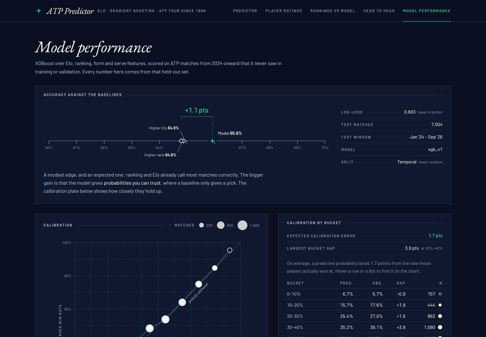
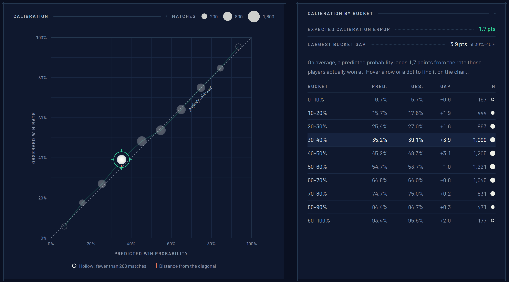
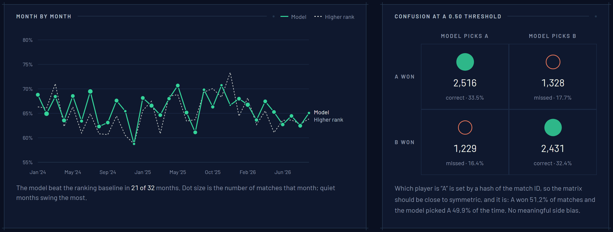
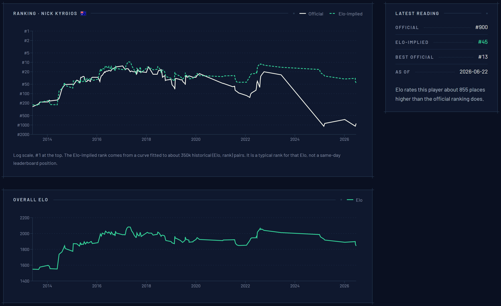
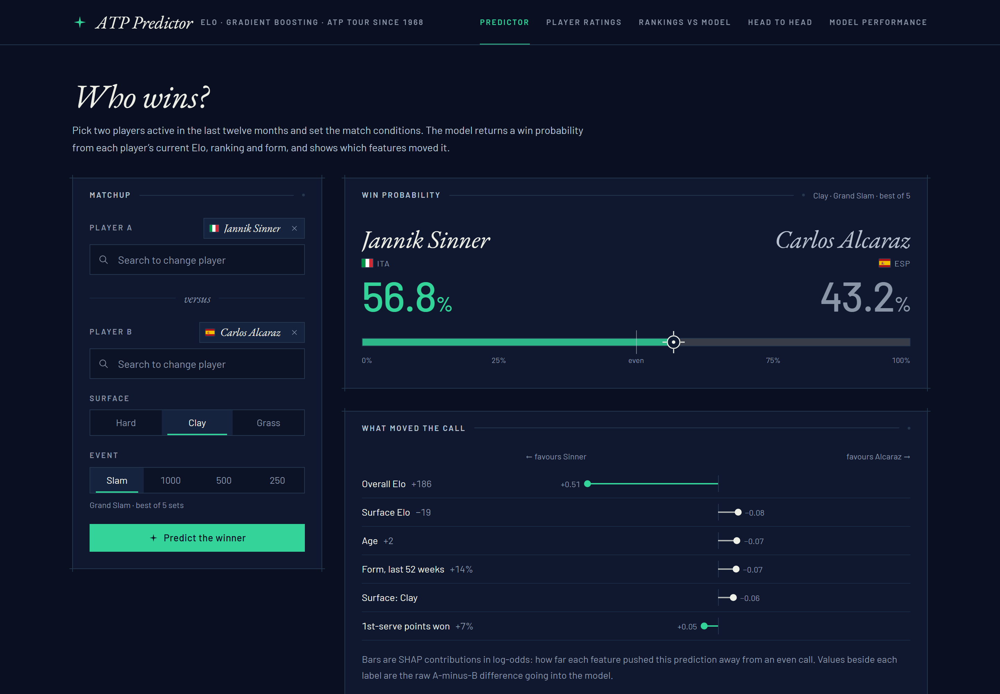
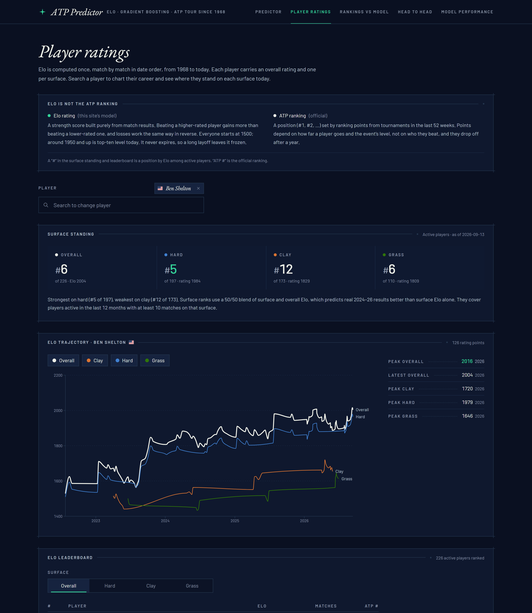
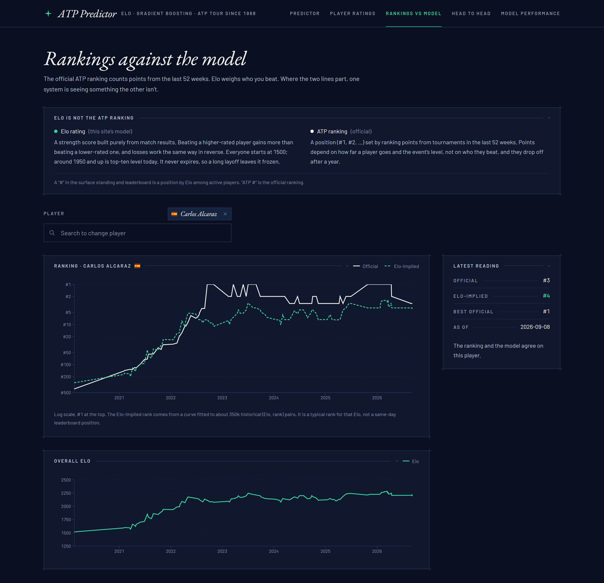
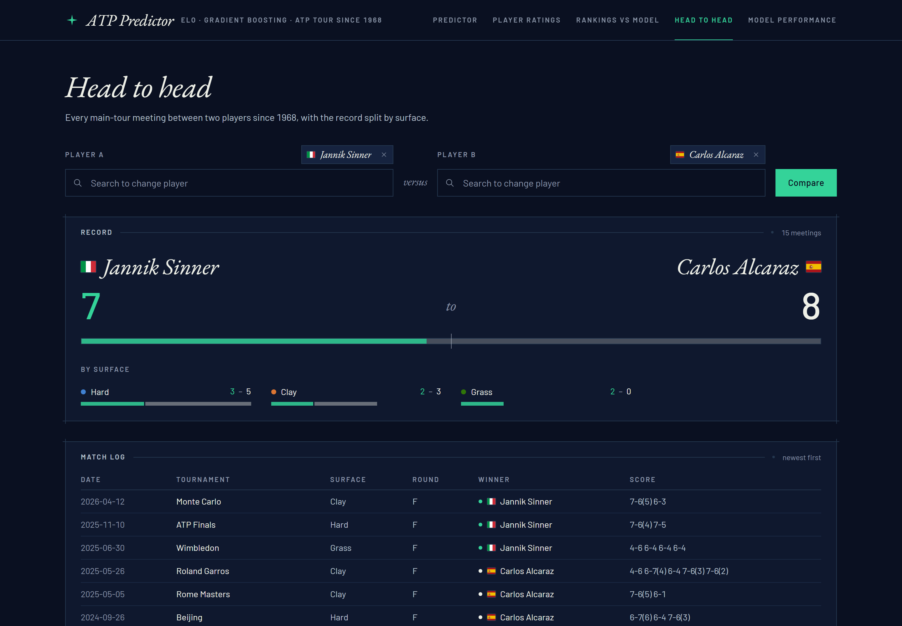
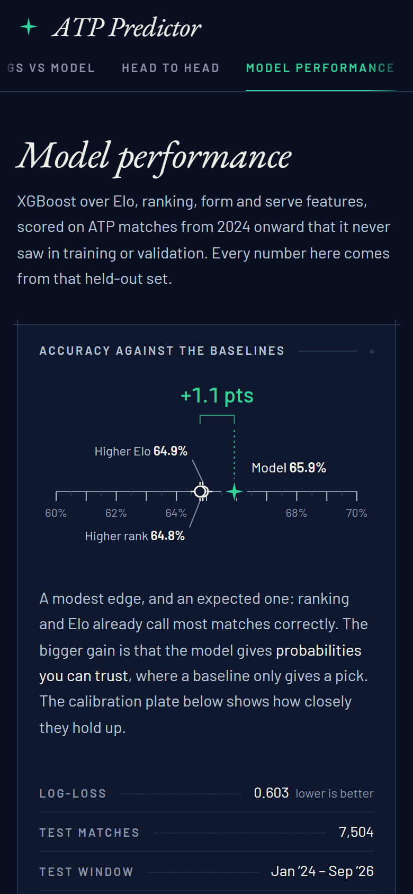
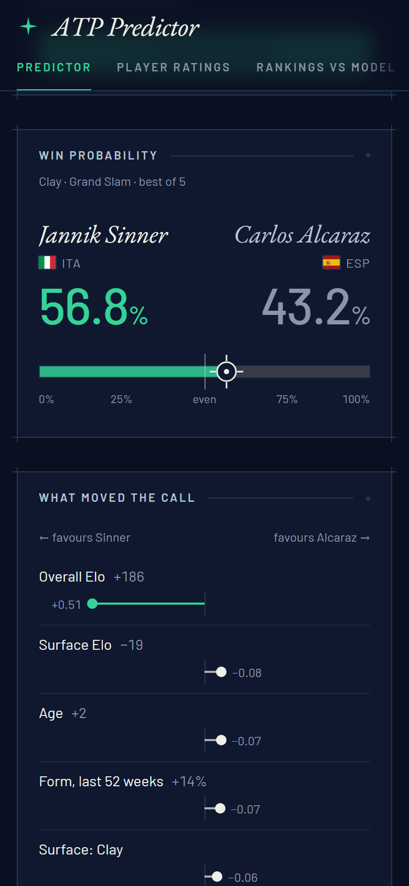

# ATP Predictor & Analytics Dashboard

A full-stack ATP match prediction and analytics tool. It has a from-scratch Elo rating engine, a gradient-boosted classifier trained on top of it, and a React dashboard for exploring both. The dashboard includes a live "who wins" predictor and a model-performance tab built on a proper temporal backtest.

Built as the predictive-ML entry in a small portfolio of data/full-stack projects, alongside an NLP sentiment indexer, a gym analytics dashboard and a housing-affordability dashboard.



## Why

Most "tennis predictor" toy projects report a single accuracy number and stop there. The interesting part of this problem is everything around that number:

- avoiding lookahead leakage in a time-series dataset
- reshaping outcome-labelled data (`winner`/`loser`) into a symmetric, leakage-free training set
- being honest about how much a trained model actually beats a naive baseline

This project is built around getting those parts right, not around squeezing out a few extra points of accuracy.

## The model

Trained on 194,407 matches from 1968 to 2023 with a temporal split: training uses matches before 2023, validation uses 2023, and the test set is 2024 onward. That test set is 7,504 matches the model never saw during training or validation. A random split would leak future rank/Elo information into earlier matches, so it isn't used.

| | Accuracy | Log-loss |
|---|---|---|
| **Model (XGBoost)** | **65.9%** | **0.603** |
| Baseline: always pick the higher-ranked player | 64.8% | — |
| Baseline: always pick the higher-Elo player | 64.9% | — |

A ~1-point edge over the ranking/Elo baselines is modest but real. It's consistent with the tennis-prediction literature, where rank and Elo are already strong predictors and hard to meaningfully beat. The bigger value of the trained model over the baselines is *calibrated probabilities*. A baseline only gives you a pick, not a probability you can trust.

Top features by importance are overall Elo difference, surface-specific Elo difference and ranking difference. The rest of the feature set (recent form, head-to-head, serve stats, physical attributes) contributes at the margins.

### Calibration



Test-set predictions are bucketed into deciles, and each bucket's average predicted probability is compared with how often those players actually won. Across the 7,504 test matches, a prediction lands on average **1.7 points** from the observed win rate (expected calibration error). The worst bucket, 30–40%, is off by 3.9 points.

Dot size is the number of matches in each bucket. Buckets with fewer than 200 matches are drawn hollow so thin evidence doesn't look as solid as thick evidence.

### Month by month



Both the model and the ranking baseline are re-scored for every month of the test window. The model beats the baseline in 21 of 32 months. Month-to-month swings are large because a month holds only a few hundred matches. That's why the overall test-set figure, not any single month, is the headline number.

The confusion matrix doubles as a check on the A/B reshaping. Side "A" is assigned by a hash of the match ID, so the matrix should come out close to symmetric. It does: A won 51.2% of test matches, and the model picked A 49.9% of the time.

### A known blind spot: inactivity (Nick Kyrgios)



Kyrgios is one of the starkest gaps between the two systems, and it exposes a real limitation of the Elo engine.

**What each line is measuring:**
- The **official ranking** only counts points from the last 52 weeks. After a long injury layoff his points expired, and he fell from a peak of #13 to about #900–1100.
- **Elo has no inactivity decay.** A rating only moves when a player plays, so it stays frozen through a layoff. Since October 2022 he has played 10 main-tour matches, mostly after long gaps, and gone 2–8. That has pulled his Elo down from about 2040 to 1843, but 1843 still implies roughly #45.
- The long straight segments in the chart (2023–2025) are interpolation across months with no matches, not data.

**Neither number is "right".** Elo answers "how good was this player when we last saw them?" The ranking answers "how much has this player won recently?" For someone returning from long-term injury, the truth is probably somewhere in between and very uncertain. Elo can't express that uncertainty.

**What the model does with the conflict.** For Kyrgios against Alexei Popyrin (official #130, Elo 1706) in a grass-court ATP 250, the model gives Kyrgios **57%**. The ranking gap is the largest single push against him (−0.79 log-odds). The overall and grass Elo gaps push the other way and win out (+0.41 and +0.67).

Whether 57% is right is genuinely debatable. The training data contains few comebacks like this, so the model has little evidence on how much to trust a stale Elo.

**Doesn't the model already see the last 52 weeks?** Yes. Three of its features are built on 52-week signals: ranking difference, ranking-points difference and win rate over the last 52 weeks. That's why the ranking gap is the biggest single push against Kyrgios above.

Elo deliberately has no window. It's a running estimate with a long memory of who a player has beaten, and that memory is why it slightly out-predicts the ranking on the test set (64.9% vs 64.8%). Cutting Elo down to 52 weeks would just turn it into a noisier copy of the ranking.

So the gap isn't a missing 52-week view. The model has two conflicting signals, a frozen Elo and an expired ranking, and nothing that tells it *why* they conflict.

**Possible fixes (future work):**
- **Days since last match as a feature,** so the model can learn how much to discount stale ratings.
- **Rating decay or rising uncertainty during inactivity.** For example, switch to a Glicko-2-style rating, where a player's rating deviation grows the longer they're out. This is the more principled fix.
- **Surface ratings that start from overall Elo.** Start each surface rating at the player's overall Elo rather than 1500, and base the K-factor on matches played on that surface. This targets the lag described under Player Ratings below.

## The dashboard

Five tabs, all reading from the FastAPI backend. Player search lists active players first, and players show their country flag throughout. Charts use one colour per surface (blue hard, orange clay, green grass), checked to stay distinguishable for colour-blind viewers.

### Predictor



Pick two active players, a surface and an event level, and get a live win probability. Below it are the features that drove that specific prediction, as XGBoost's native SHAP contributions, each pointing toward the player it favours.

**The controls are limited to inputs that actually move the model:**
- **Surface: Hard, Clay or Grass.** Surface Elo is the second most important feature. Carpet isn't offered, because it left the tour years ago (the last carpet match in the data is from 2017).
- **Event: Grand Slam, Masters 1000, 500 or 250.** Event level on its own shifts a prediction by under a point. Its real effect is the match format: best of 5 sets at Grand Slams, 3 elsewhere. The format is set automatically from the event and moves a prediction by about 3 points.
- **No round picker.** Round isn't a model feature, so an earlier version's round control changed nothing; a first round and a final gave identical probabilities.

Matchups are kept in the URL, so a link reproduces the exact prediction. For example: `/?a=S0AG&b=A0E2&surface=Clay&level=G`.

### Player Ratings



Shows a player's Elo trajectory over their career, overall and per surface, on a true time axis, with peak and latest ratings listed beside the chart. A short key at the top of this tab and Rankings vs Model explains how Elo differs from the official ATP ranking, so the two numbers aren't confused.

Above the chart, **Surface standing** ranks the player against everyone active in the last 12 months, separately for overall, hard, clay and grass. Below it, a **leaderboard** lists the top 20 for each surface alongside their official ATP rank. Clicking a name loads that player.

**How surface rankings are judged.** The first version ranked players by surface Elo alone, and it didn't hold up. Marin Čilić came out #6 on grass despite opening-round losses at Queen's and Wimbledon in 2026. Every surface rating starts at 1500, and grass has a five-week season: the median active player has only 26 career grass matches, so most ratings are still climbing. A veteran with 123 grass matches and a strong peak sat above better players who simply hadn't played much on grass.

Rather than pick a fix by eye, I scored the options on how well each predicts every 2024–26 hard, clay and grass match (7,783 matches, using ratings from before each match):

| Rating used for surface rankings | Log-loss (all) | Log-loss (grass) |
|---|---|---|
| Surface Elo only (first version) | 0.642 | 0.653 |
| Overall Elo only | 0.634 | 0.631 |
| Surface/overall blend weighted by surface match count | 0.631 | 0.633 |
| **50/50 blend of surface and overall Elo** | **0.629** | **0.621** |

The simple 50/50 blend predicted best, so surface rankings now use it, with the raw surface Elo shown beside it. Čilić drops to #23 on grass. Ben Shelton is #5 on hard but #12 on clay: still a hard-court specialist, without the noise.

Players need at least 10 matches on a surface to be ranked on it at all.

The same flaw sits inside the model, whose second most important feature is the surface Elo difference. XGBoost also sees overall Elo, so it can partly learn the blend itself. A cleaner fix in the Elo engine is listed under future work: start each surface rating at the player's overall Elo, and base the K-factor on matches played on that surface.

### Rankings vs Model



Compares the official ATP ranking with the rank implied by the player's Elo. The Elo-implied rank comes from a curve fitted to ~350k historical (Elo, rank) pairs. The two measures sit on separate stacked charts that share a time axis, rather than one chart with two y-axes. The Kyrgios section above walks through one large gap and what causes it.

### Head to Head



Shows every main-tour meeting between two players since 1968, with the record split by surface.

### On a phone

<p>
  
  &nbsp;
  
</p>

The dashboard is desktop-first, but every tab works at 390px wide with no sideways scrolling.

## Data

[TennisMyLife](https://stats.tennismylife.org) is an MIT-licensed, continuously updated ATP match database covering 1967 to the present. This project uses ATP main-tour matches only (200,054 of them), with no Challenger, WTA or qualifying data. There's also no separate weekly-rankings ingestion, because the match data already carries each player's rank at the time of the match, which is what the model needs.

## How the leakage-prone parts were handled

- **Elo is computed once, in strict chronological order.** It's stored per player, per surface, per date, and never recomputed live per request.
- **Every match is reshaped from `(winner, loser)` into `(player_A, player_B)`.** A hash of the match ID decides which side is A, rather than "the winner is always A". Otherwise a model trained on winner/loser columns just learns "column 1 always wins", and accuracy becomes meaningless.
- **All features are pre-match only.** Rolling form, rolling serve stats and Elo are all snapshotted *before* the match being featurised, from state built by replaying history forward in date order. A match's own outcome never leaks into its own features.
- **Training and the live API share one feature-construction function** (`features.py`). There's no risk of training and serving computing "the same" feature two subtly different ways.
- **Retirements and walkovers are excluded from training.** They still count for Elo and form updates, since a retirement is still a completed result. But "player got injured mid-match" isn't really a signal about who was better.

## Stack

- **Backend:** FastAPI + SQLite (SQLAlchemy)
- **ML:** pandas, scikit-learn, XGBoost; Elo engine hand-rolled, no library
- **Frontend:** React + Vite + Tailwind + Recharts, with hand-drawn SVG for the accuracy ruler, calibration plot and monthly chart; country flags from `flag-icons`
- **Deployment:** Raspberry Pi 4, systemd services plus a systemd timer for the daily data refresh

## Project structure

```
backend/
  app/          # FastAPI app, SQLAlchemy models, Elo engine, shared feature builder, routes
  ml/           # ingestion, Elo replay, dataset build, training, backtest (one-off scripts)
frontend/
  src/pages/    # the five dashboard tabs
  src/ui/       # shared panels, states, controls and chart styling
docs/
  screenshots/  # images used in this README
scripts/        # deploy + systemd units for the Pi
```

## Running it locally

```bash
# Backend
cd backend
python -m venv .venv && .venv/Scripts/activate  # or source .venv/bin/activate on Linux/Mac
pip install -r requirements.txt
python -m ml.ingest        # pulls ~200k matches from stats.tennismylife.org, one-time
python -m ml.build_elo     # replays match history, builds Elo ratings
python -m ml.build_dataset # builds the pairwise training set
python -m ml.train         # trains the model
python -m ml.backtest      # scores the held-out test set for the Model Performance tab
uvicorn app.main:app --port 8002

# Frontend (separate terminal)
cd frontend
npm install
npm run dev  # http://localhost:5175
```

## Non-goals

No user accounts, no WTA/Challenger/qualifying data, no point-by-point in-match prediction, and no mobile app. These are deliberate scope decisions, not gaps.
